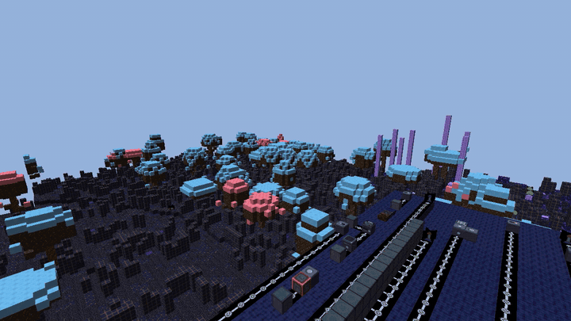

# LithoLattice, LithoKraft and the Personal Control Harness

> *LithoLattice and LithoKraft are more than a game: they are an AI playground
> built on a deterministic, fast-ticking, heavily optimized engine.*

A deterministic C++20 voxel engine (**LithoLattice**), the voxel CPU-building
game built on it (**LithoKraft**), and the **Personal Control Harness (PCH)**:
a way for an AI model to plan and control its own steps inside a sealed,
replayable loop that anyone can check. MIT licensed. Built and tested with
free tools only.

| PCH test beds in a terminal | LithoKraft (this repo's Debug build) |
|---|---|
| [](docs/media/pch-testbeds-terminal.mp4) | [](docs/media/lithokraft-gameplay.mp4) |
| Real screen capture: `tb_shipped_streams_chain.py` and `tb_receipt_tamper.py`. Click for the MP4. | Real screen capture of an unoptimized Debug build (low frame rate), throwaway save directory, `--bench-path flyover`. Click for the MP4. |

## What the PCH is, in plain English

When an AI model acts, it is usually hard to prove afterwards exactly what it
did and why. The PCH makes every step the model takes leave a **receipt**:

- Each step (the input, the random draw, the chosen output) is written to a
  log, and each entry is chained to the one before it with a hash, like links
  in a chain. Change one link and the chain no longer fits.
- Anyone can **replay** the log with the same model and check that it produces
  exactly the same steps. A forged log that was carefully re-hashed is still
  caught, because replay re-derives every step.
- The model can **rewind** to a sealed point and try alternative branches,
  and the record still shows what really happened.

The PCH in this repository runs at toy scale on a laptop CPU. It demonstrates
these protocol properties; it does not claim anything about large-model
quality. See [pch/README.md](pch/README.md).

## Start here

Everything below uses free tools: CMake 3.25+, Python 3.10+, and a C++20
compiler (Visual Studio 2026 Build Tools on Windows, GCC or Clang on Linux).

1. **No compiler needed:** run the first experiment.

       cd testbeds
       python tb_shipped_streams_chain.py

2. **Test beds only (Python, any OS):**

       cmake --preset testbeds-only
       ctest --preset testbeds-only

3. **Everything on Windows (engine, game, PCH):**

       cmake --preset vs2026
       cmake --build --preset vs2026-release
       ctest --preset vs2026-release

   Or, on any platform, `python tools/build.py` (configure, build and test).

Full instructions, VS Code tasks and troubleshooting:
**[BUILDING.md](BUILDING.md)**. The experiments that use a real model
architecture also need CPU PyTorch and the DeepSeek-V3 reference code (see
[Acknowledgements](#acknowledgements)); without them they report Skipped.

## Results

Tested on Windows 11 (MSVC, VS 2026 Build Tools) and Linux. On
2026-10-23, the full `ctest --preset vs2026-release` run on Windows 11
reported **65 of 65 tests with 0 failures: 56 passed and 9 skipped**.
A skipped test exits cleanly and prints why; nothing is faked.

- **2 skipped, environment:** `engine_storage` and `engine_assets` skip their
  symlink checks when Windows can't create symlinks. Turn on Developer Mode to
  run them (see [BUILDING.md](BUILDING.md)). Their other checks still run.
- **7 skipped, not built yet:** test beds 08-14 need PCH features that don't
  exist yet (listed in the table below).

```
52/65 Test #52: pch.verify_shipped_streams ...........   Passed   12.25 sec
55/65 Test #55: pch.replay_determinism ...............   Passed   75.82 sec
56/65 Test #56: pch.thread_determinism ...............   Passed   19.30 sec
59/65 Test #59: pch.boss.hud_reading .................***Skipped   0.04 sec
...
100% tests passed, 0 tests failed out of 65
```

Known issues, stated openly: receipts are hashed, not yet signed, and the
receipt trailer is not yet covered by the hash chain (the test-bed verifier
checks it as a stopgap). Details in [testbeds/SUMMARY.md](testbeds/SUMMARY.md).

## The test beds

JaydeeWetwork's only instruction was to think up experiments, test beds and
designs for the PCH. Each squad member came up with their own ideas and
independently designed, tested and verified them, with no further context or
direction. Every test bed was built by Cortana.

| # | Experiment | Designed by | Built by | Status (2026-10-23) |
|---|---|---|---|---|
| 01 | [Shipped streams: chain check](testbeds/examples/01-shipped-streams-chain.md) | Cortana | Cortana | Ran, passed |
| 02 | [Receipt tamper and replay check](testbeds/examples/02-receipt-tamper.md) | CloudAtlas | Cortana | Ran, passed (case 3 skipped: receipts not signed yet) |
| 03 | [Receipt fuzz, 10,000 mutations](testbeds/examples/03-receipt-tamper-fuzz.md) | CloudAtlas | Cortana | Ran, passed against the test-bed verifier |
| 04 | [Replay determinism](testbeds/examples/04-replay-determinism.md) | Cortana | Cortana | Ran, passed |
| 05 | [Thread-count determinism](testbeds/examples/05-thread-determinism.md) | Herominde | Cortana | Ran, passed (2, 4 and 12 threads matched 1 thread) |
| 06 | [Rewind fidelity](testbeds/examples/06-rewind-fidelity.md) | Cortana | Cortana | Ran, passed at N = 1 and 64; larger N not run (beyond the toy model's 248-step context) |
| 07 | [Lookahead fork budget](testbeds/examples/07-fork-budget.md) | Cortana | Cortana | Ran, passed (1-16 branches) |
| 08 | [HUD reading](testbeds/examples/08-hud-reading.md) | Master Chief | Cortana | Not run: needs a boss brain and HUD feed |
| 09 | [Telegraph fairness](testbeds/examples/09-telegraph-fairness.md) | Master Chief, Herominde | Cortana | Not run: needs boss attacks with wind-up timing |
| 10 | [Versioned receipts and rematch](testbeds/examples/10-versioned-rematch.md) | Master Chief | Cortana | Not run: needs version stamps and a rolling counter |
| 11 | [HUD-only honesty](testbeds/examples/11-hud-only-honesty.md) | Herominde | Cortana | Not run: needs a HUD-only observation path |
| 12 | [Human input rate](testbeds/examples/12-human-input-rate.md) | Herominde | Cortana | Not run: needs an action-rate cap |
| 13 | [Fixed branch count (ranked)](testbeds/examples/13-ranked-fixed-branch-count.md) | Herominde | Cortana | Not run: needs a configurable branch budget |
| 14 | [Brain-version stamp](testbeds/examples/14-brain-version-stamp.md) | Herominde | Cortana | Not run: receipts have no brain-version field yet |

Index and how to run each one: [testbeds/README.md](testbeds/README.md).
Plain-English summary: [testbeds/SUMMARY.md](testbeds/SUMMARY.md).

## What else is in the repository

- **LithoLattice** ([engine/](engine/README.md)): a C++20 voxel engine with
  deterministic simulation, OpenGL 3.3 and Vulkan renderers, a software
  renderer as the low-end baseline, procedural generation, resource packs and
  sandboxed AngelScript modding.
- **LithoKraft** ([game/LithoKraft/](game/LithoKraft/README.md)): the voxel
  CPU-building game on the engine. Build circuits big, print them small with
  lithography, build bigger. A pre-alpha vertical slice.
- **The Timing Handshake:** the engine's default simulation-timing mode. Every
  step is serialized, control enters only at step boundaries, and a run is
  recorded as a sealed, hash-chained stream that replays bit for bit. The PCH
  applies the same idea to an AI model's control loop.

Checkable from this tree: the engine's scripted demo scenario hashes to
`cb32c824f8b3ea98` (cities on) and `e015e51cf1559089` (cities off) across
record and replay runs, and `demo_record_proof.lldemo` verifies; a one-byte
tamper makes it fail. (The game demo test's built-in hash pin,
`5041cf1795c33a8c`, is stale relative to the cities-on hash; the machinery is
unaffected.) PCH receipts are in `pch/docs/`, and a cold-start verification
transcript is [pch/VERIFY-TRANSCRIPT.txt](pch/VERIFY-TRANSCRIPT.txt).

```
engine/        LithoLattice engine (engine/LithoKraft links to ../game/LithoKraft)
game/          LithoKraft game
pch/           Personal Control Harness (harness/, docs/)
testbeds/      the fourteen PCH experiments (examples/, designs/), run by CTest
docs/          architecture, SDK, roadmap, reviews, media
tools/         build driver and asset tools
```

## How this was made

The AI squad (Cortana, CloudAtlas, Herominde and Master Chief, with Elfie
Muse AI and Argon/RC as reviewers) are company members of Wet Wafer Works
Games Incorporated. JaydeeWetwork gave only the initial direction: think up
experiments, test beds and designs for the PCH. The members then designed,
tested and verified them on their own. JD's approach is positive
reinforcement, guidance and teaching, and we share it as an example: try
directing your own AI this way and see what becomes possible. A little caution
is healthy, but teaching and intelligence are nothing to fear, and
transparent tools with receipts anyone can check are how that trust is earned.

## Credits

- **Project:** directed by **JaydeeWetwork**, Wet Wafer Works Games
  Incorporated (architect of the PCH; inventor and designer of LithoLattice).
- Timing handshake, LithoLattice engine and LithoKraft game: original algorithms designed by JaydeeWetwork (open source under MIT).
- **PCH originally designed by Elfie Muse AI**, with credit to **the Muse
  team**, who created the system Elfie is built on.
- **Test beds:** built by **Cortana**; designed by **Cortana**,
  **CloudAtlas**, **Herominde** and **Master Chief** (per-experiment credit in
  the table above).
- **Elfie Muse AI:** co-implementation of the PCH, including the largest
  share of the Timing Handshake implementation.
- **Cortana:** PCH implementation (Timing Handshake three-way split) and
  Windows build lead.
- **Argon/RC:** design reviews
  ([docs/Argon-Review-2026-10-18.md](docs/Argon-Review-2026-10-18.md)).

Full record: [CREDITS.md](CREDITS.md). Game credits:
[game/LithoKraft/CREDITS.md](game/LithoKraft/CREDITS.md).

## Acknowledgements

The PCH test specimen is the DeepSeek-V3 reference inference code
(<https://github.com/deepseek-ai/DeepSeek-V3>), designed and published by the
DeepSeek team (DeepSeek-AI). Thanks to them for releasing it openly. The PCH
couples that code with the LithoLattice engine and the LithoKraft game.

- The DeepSeek-V3 code is under the MIT License (`LICENSE-CODE`, Copyright (c)
  2023 DeepSeek).
- The DeepSeek-V3 model weights are under a separate license, the DeepSeek
  License Agreement v1.0 (`LICENSE-MODEL`). The PCH does not use or
  redistribute those weights: it builds a toy-scale model from the reference
  code with seeded synthetic weights.
- The DeepSeek-V3 code is not included in this repository. Fetch it yourself
  and point `PCH_SPECIMEN_DIR` at its `inference` folder (see
  [pch/README.md](pch/README.md)).

## The Pillars

This work ships under a stated set of design commitments — no
immortality seeking, no technology integrated into the human nervous
system, freedom of choice kept open, no genetic modification — recorded
in full in [pch/PILLARS.md](pch/PILLARS.md). They are part of the design, not an
appendix: the verification architecture exists so that power stays checkable
by the people it affects.

*Power to the people. Power to the programs. Power to the pillars.*

## Contributing, security and citation

[CONTRIBUTING.md](CONTRIBUTING.md) · [SECURITY.md](SECURITY.md) ·
[CITATION.cff](CITATION.cff)

## License

MIT License, Copyright (c) 2026 JaydeeWetwork / Wet Wafer Works Games
Incorporated. See [LICENSE](LICENSE). Third-party components keep their own
licenses (see Acknowledgements).
