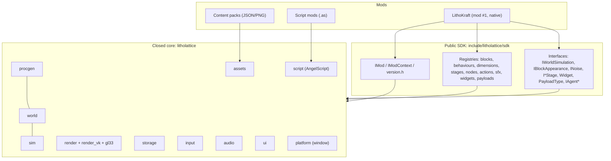
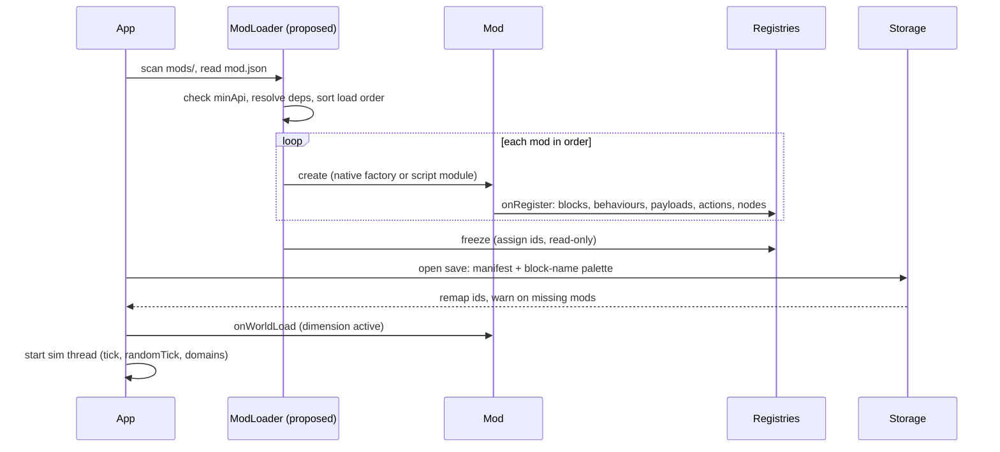
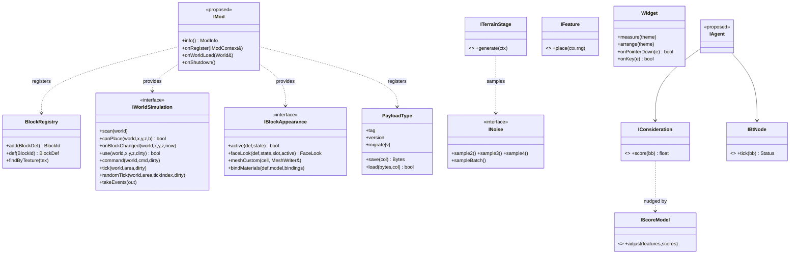

# LithoLattice SDK: API framework design

Status: design draft, 2026-10-09. Engine HEAD `e5dac77`.
Legend: **[EXISTS]** is in the code today (the class or function named is real). **[PROPOSED]** is the design only, with no code yet. **[PARTIAL]** means the mechanism exists but its SDK form (header location, stability promise) does not.

---

## 1. Goals

- **Half-Life-style SDK.** The LithoLattice core (world, sim thread, renderers, storage, platform, audio, UI, procgen, script host) is a **closed, proprietary** library. Modders get public headers, the import/static libraries for the engine, documentation, and the full source of a sample game. Like the HL1 SDK, the "game" layer is the documented extension point, and the engine internals are not.
- **Public virtual interfaces and stubs.** Every extension point is an abstract class (`I...`) or a registry that takes plain data or a factory. Optional hooks have default no-op bodies (stubs), so a mod overrides only what it needs. `IWorldSimulation::randomTick` is the pattern: it was added with an empty default, and existing code did not have to change.
- **LithoKraft is mod #1.** LithoKraft (`lithokraft::`) uses only the public engine API. Anything LithoKraft needs that third-party mods cannot get is an SDK bug. The engine holds no game content: `kAir` plus generic types only. **[EXISTS]** since the engine/game split.
- **Not open source.** The SDK license allows building and distributing mods. It does not allow redistributing engine binaries outside the game, or the engine source (none is shipped). The sample-game source ships under a separate permissive mod license (open question Q1).
- **Non-goals for v1:** a stable C ABI for every module, DLL hot-swap at runtime, and a console/marketplace distribution pipeline.

## 2. Public API surface by module

Namespaces: engine = `litholattice::` (sub-namespaces `procgen::`, `ui::`, `storage::`). Game/mod = its own namespace (`lithokraft::` for mod #1).

### 2.1 Blocks: registry and block types (`world`)
- **[EXISTS]** `BlockRegistry` (`world/block.h`): dense `BlockId` table. `add(BlockDef)` returns the id. `def()`, `has()`, `hasAll()`, and `findByTexture()` are used by worldgen JSON. Row 0 is `kAir`. It is built once at startup, then shared read-only across threads.
- **[EXISTS]** `BlockDef`: `name`, `flags` (engine `BlockFlags` plus game bits), `Shape {None, Cube, Cross, Slab, Custom}`, `tex` (pack key), `behavior` (a name the engine never reads), and opaque game payload fields `role`, `channel`, `tier`.
- **[EXISTS]** `CellState`, a per-cell 16-bit state with helpers (`stOn`, facing via `makeState`), plus the `kDirectional` flag.
- **[PROPOSED]** *Namespaced ids for multi-mod*: `"lithokraft:lamp"`. The registry keeps a name-to-id map. Ids stay dense at runtime, and saves store a name palette (see 2.9) so load order can change without corrupting worlds.
- **[PROPOSED]** *Attach-face state* for attachables (switch/lever, torches): a reserved 3-bit `attachFace` in `CellState`, a `kAttachable` flag, and `IAttachRules { bool canAttach(world, pos, face); void onSupportRemoved(...) }`. The default drops the item.

### 2.2 Sim: components and behaviors (`sim` + game)
- **[EXISTS]** `IWorldSimulation` (`sim/world_simulation.h`) is the game's simulation, called only on the sim thread:
  - `scan(world)`: once, when a dimension becomes active
  - `canPlace(...)`: veto
  - `onBlockChanged(...)`
  - `use(...)`: right-click
  - `command(SimCommand)`: game-defined
  - `tick(world, TickArea, dirty)`
  - `randomTick(world, area, tickIndex, dirty)`: **stub**, default no-op
  - `activeCount()`, `takeEvents()`
- **[EXISTS]** `SimThread`: fixed-step loop and `ClockDomain`s. A clock domain is a game-named rate (power of two, up to 512 Hz) with a `step` callback. It also handles edits from the main thread, remesh snapshots, and `takeChangedColumns()` for partial saves.
- **[EXISTS, game side]** LithoKraft's `BlockBehavior` / `ComponentBehavior` (`tick(inputs, state, mem) -> ComponentStep`, `emitToward`, `use`, `describe`) and `BehaviorCatalog` (name -> behaviour, bound through `BlockDef::behavior`). These live in `lithokraft::`, so the engine has no notion of "component".
- **[PROPOSED]** Promote a generic `IBlockBehavior` / `BehaviorRegistry` into the SDK (`sdk/sim/behavior.h`) so that script and native mods can add components without patching LithoKraft's catalog. LithoKraft's `ComponentBehavior` becomes one *kind* of behavior registered by mod #1.
- **[PROPOSED] Random ticks** (decided in the brief): the engine picks **8 random cells per 16x16x16 section per world tick** around the player. This is configurable per dimension, runs at the world TPS only, and is not scaled by beacons. Each chosen cell goes to `IRandomTickHandler::onRandomTick(world, x, y, z, rng, dirty)`, registered per block id. Cells changed through `dirty` are marked for saves (this mechanism exists). The existing `randomTick` hook stays as the low-level, whole-area escape hatch.

### 2.3 Dimensions, procgen generators and noise nodes (`world`, `procgen`)
- **[EXISTS]** `Dimension` (id, name, biomes, `ColumnGenerator`, `SetupFn` for structures and spawn, `belowWorldFill`) and `DimensionRegistry` (`add`, `addAlias`, `find`).
- **[EXISTS]** `ColumnGenerator::create(json, worldSeed, dimensionId, blocks, err)`: generators are data (JSON graphs) and thread-safe.
- **[EXISTS]** Pipeline stage interfaces (`procgen/pipeline.h`): `IClimateStage`, `IBiomeSelector`, `ITerrainStage`, `ISurfaceRule`, `ICarver`, and `IFeature::place(ctx, rng)`, with built-in implementations in `stages.h` (`HeightmapTerrain`, `DensityTerrain`, `LayeredSurface`, `WormCaveCarver`, `RavineCarver`, `MultiNoiseBiomeSelector`, ...).
- **[EXISTS]** Noise: `INoise` (`sample2/3/4`, `sampleBatch`), `NoiseType`, `NoiseSettings`, and the JSON node graph (`NoiseGraph`, `NodeDesc`, `GraphDesc`, `GraphContext`).
- **[PROPOSED]** `NoiseNodeRegistry` and `StageRegistry`, so mods add node types (`"mymod:terrace"`) and stages by name. The JSON loader resolves names through these registries instead of a built-in switch.

### 2.4 Render: materials, appearance, models (`render`, `assets`)
- **[EXISTS]** `IRenderer` (backend-neutral; Vulkan and GL 3.3). Mods never implement it. They see `MaterialBindings` / `BlockMaterials` and `IBlockAppearance`:
  - `active(def, state)`
  - `faceLook(def, state, slot, active)`
  - `meshCustom(CustomBlock, MeshWriter&)`
  - `bindMaterials(def, model, bindings)`
- **[EXISTS]** `BlockModel` / `BlockModelSet` / `FaceLayout` / `FaceSlot` / `WirePiece` (`assets/block_model.h`): pack-defined face layouts. `Shape::Custom` plus `meshCustom` is the hook for non-cube geometry today.
- **[PROPOSED] Custom 3D block models** for attachables (switches, torches, buttons): a JSON box-list model format (`elements: [{from, to, faces{uv, tex}}]`, rotations by `attachFace` and facing). The engine meshes it, so mods don't write `meshCustom` code.
- **[PROPOSED] Normal and height maps**: optional `*_n.png` and `*_h.png` beside each texture in a pack. They need a second and third texture-array layer set, a tangent basis derived per face (axis-aligned faces, so no per-vertex tangents), and a material flag.
- **[PROPOSED] Parallax occlusion and tessellation displacement** on Vulkan and GL 4.x, off on GL 3.3. These are quality settings, not mod API. Packs only supply the height maps.
- **[EXISTS]** Display modes (`platform/window.h`: `DisplayMode`, `DisplayDesc`, Alt+Enter) are engine and app settings, not mod API.

### 2.5 Assets and resource packs (`assets`)
- **[EXISTS]** `ResourcePack`, `ResourceLoader`, `TextureRegistry`, `ShaderLibrary` (GL GLSL only), `Image::decode` (hardened), and pack `manifest.json` plus `pack.json`.
- **[PROPOSED]** A pack stack with priority: base game, then mods in load order, then user resource packs. A later pack overrides keys. The existing hot-reload diff (`hot reload diff` selftest) extends to the stack.

### 2.6 Input: actions and contexts (`input`)
- **[EXISTS]** `ActionSet` (named actions, `ActionKind {Button, Axis2D}`), `ActionMap` / `Binding` (keys, mouse, pad, rebinding), `InputContext` and `ContextRules` (which actions a context blocks or passes; raw UI and text channels), `InputSystem`, `DeviceState`, and `IInputBackend`.
- **[PROPOSED]** Mods register an `ActionSet` fragment with namespaced names and default bindings. The engine detects and reports binding conflicts (including the reserved Alt+Enter) in the controls panel.

### 2.7 Audio: synth voices (`audio`)
- **[EXISTS]** `AudioEngine` (lock-free command queue to the audio thread), `Synth`, `Voice` (`Waveform {Pulse, Triangle, Saw, Noise, Wave}`, `Duty`, `Adsr`/`Envelope`, `Lfsr`), `NoteSpec`, `VoiceAllocator`, and `AudioOutput` (miniaudio). Game SFX and music definitions live in LithoKraft (`sfx.h`, `music.h`).
- **[PROPOSED]** `SfxRegistry` (name -> notes, loadable from JSON) and a sample-playback voice for packs (`Waveform::Wave` exists as the seed).

### 2.8 UI: widgets and themes (`ui`)
- **[EXISTS]** Retained tree: `Widget` (virtual `measure`, `arrange`, `hitTest`, `onPointer*`, `onKey`, `onText`, `onFocusChanged`) plus containers, controls, lists, menus, `TextEdit`, `Dialog`, `UiRoot`, `Theme` (per-class styles from JSON), `WidgetFactory` (JSON layouts), and the injected `IUiRenderer` / `IClipboard`.
- **[PROPOSED]** `WidgetFactory::registerType("mymod:gauge", factory)` for native widget types. Script mods compose existing widgets from JSON and bind events to AngelScript handlers.

### 2.9 Storage: payload serializers and migrations (`storage`)
- **[EXISTS]** `PayloadType {tag fourcc, version, save, load, migrate[v] -> v+1}` and `PayloadRegistry` (the engine registers `BLKS`; LithoKraft registers `SGNL`). Also `RegionFile` (32x32 columns, CRC, atomic swap), `WorldStore` (I/O thread, `saveAsync`, `enqueue`), and partial saves driven by `SimThread::takeChangedColumns()`.
- **[PROPOSED]** A mod-scoped tag namespace (fourcc plus mod id in the record header). A save-level manifest records the mods and versions it was written with, plus the block-name palette (2.1). Unknown payloads are *kept verbatim* (not dropped) so that removing a mod and adding it back loses nothing (today they are skipped).

### 2.10 Scripting: AngelScript (`script`)
- **[EXISTS]** `ScriptEngine`: sandboxed (only `string`, `log`, plus what the game binds), wall-clock budgets per call, `loadDirectory`/`reload` with keep-previous-on-failure, and `raw()` for the game to bind its API.
- **[PROPOSED]** A stable script API layer: `ll::` (engine: blocks, world queries, UI, sfx, timers) and `<modid>::` (bindings a native or base mod exports). It is versioned with the SDK (section 3.3). Each script mod gets its own module, so names don't collide.

### 2.11 AI (planned; brief: utility AI plus behavior trees, learned "Daemon" nudge, 8-16 Hz)
All **[PROPOSED]**: an engine module `ai`, with mobs and NPCs as game code.
- `IAgent` (body: position, velocity, `MovementMode {Walk, Climb, Swim, Fly, Phase}` for Void entities).
- `ISense` (sight cone, hearing via signal and sound events, wire "taste" for virus mobs). Each produces percepts into a blackboard.
- `IConsideration` (utility curve over blackboard keys, 0..1) and `IAction`. The utility selector picks the top-scored action.
- Behavior-tree nodes: `IBtNode` (`Sequence`, `Selector`, `Parallel`, `Decorator`, leaf actions), registered by name and authored in JSON.
- **Learned-model hook**: `IScoreModel::adjust(span<const float> features, span<float> scores)`, called after the utility scoring. The Daemon combat model plugs in here. It is optional, with no-op stubs.
- **Waypoints**: a waypoint block or tag plus `IPathfinder` (A* over the voxel grid, budgeted per tick). Player-built NPCs get direct actions (step, use) and `goTo(waypoint|tag)`.
- AI runs on its own fixed-rate step (8-16 Hz) inside the sim thread, using a `ClockDomain`-like scheduler.

## 3. Public vs internal boundary

### 3.1 Headers layout
- **Today [EXISTS]:** each module exposes `src/<module>/include/litholattice/<module>/*.h`; private headers sit beside the `.cpp` files (for example `render_vk/vk_*.h`, `render/gl33/*`). All public-looking headers are currently "public" by location only.
- **Proposed SDK layout:**
```
include/litholattice/sdk/
  version.h          // LITHOLATTICE_SDK_VERSION_MAJOR/MINOR/PATCH, LITHOLATTICE_API_VERSION
  mod.h              // IMod, ModInfo, IModContext, LITHOLATTICE_MOD_ENTRY
  world/  block.h  dimension.h  chunk_view.h
  sim/    simulation.h  behavior.h  random_tick.h  clock.h
  procgen/ noise.h  stages.h  registry.h
  render/ appearance.h  materials.h  models.h
  assets/ pack.h
  input/  actions.h
  audio/  sfx.h  voice.h
  ui/     widget.h  theme.h  factory.h
  storage/ payload.h
  script/ bindings.h
  ai/     agent.h  utility.h  bt.h  pathing.h
```
  These SDK headers wrap or re-export the subset of module headers that is stable. Everything else (renderers, `SimThread` internals, `JobPool`, region file layout) stays internal and is not shipped.

### 3.2 ABI strategy
- **v1 (recommended): static linking only.** Native mods are compiled together with the game, the way LithoKraft is today, against a matching SDK version. C++20 types (std::string, std::function, std::vector) are allowed across the API because there is one compiler, one CRT, and one build.
- **Later, if DLL mods are wanted:** a hard boundary at `IMod` and `IModContext`:
  - Pure-virtual interfaces only, created by `extern "C" IMod* llCreateMod(uint32_t apiVersion, IModContext*)`.
  - **No STL across the boundary**: `LlStringView {const char*, size_t}`, spans as pointer plus count, callbacks as an interface pointer plus `void*`.
  - The engine owns allocation, and objects are released with `release()`.
  - `[[nodiscard]]` error codes instead of exceptions crossing the DLL boundary.
  - A fixed compiler, the MSVC v143 toolset (ABI-stable since VS 2015).
- Vtable stability rules: new virtuals are appended only at the end; never reorder or remove (mark deprecated instead); new optional hooks get stub defaults.

### 3.3 Versioning
- **Semver for the SDK.** MAJOR is breaking (a removed or changed signature, or a vtable change in DLL mode). MINOR adds hooks or registries. PATCH is fixes only.
- `LITHOLATTICE_API_VERSION` = `MAJOR * 10000 + MINOR * 100 + PATCH`. Mods declare a `minApi` and are refused on a MAJOR mismatch.
- **Deprecation policy:** mark with `[[deprecated("since 1.3, use X")]]`, keep it for at least one MINOR release and 90 days, and remove it only in the next MAJOR. Script API deprecations log once per mod.
- The save format and payload versions are independent of the SDK version (`PayloadType::version` plus migrations, which already exist).

## 4. Mod packaging

| Kind | Contents | Trust | Status |
|---|---|---|---|
| **Content pack** | `mod.json` + PNG textures + JSON (blocks, models, worldgen graphs, UI layouts, themes, sfx) | safe: data only | packs **[EXISTS]** as resource packs; `mod.json` and block JSON **[PROPOSED]** |
| **Script mod** | content + `scripts/*.as` (AngelScript) | sandboxed: only bound API, time budgets | host **[EXISTS]**; per-mod modules **[PROPOSED]** |
| **Native mod** | C++ against the SDK, static (v1) or DLL (later) | full trust | LithoKraft is the only one today **[PARTIAL]** |

- **`mod.json` [PROPOSED]:** `id`, `name`, `version` (semver), `minApi`, `dependencies` (`[{id, versionRange}]`), `loadAfter`/`loadBefore`, `permissions`, `entry` (script folder or native symbol).
- **Load order [PROPOSED]:**
  1. Engine core.
  2. Mods sorted topologically by dependencies, then `loadAfter`/`loadBefore`, then alphabetical by id (deterministic).
  3. User resource packs last (visual overrides only).
  - Registry phases are strict: *register* (blocks, behaviours, payloads, actions, nodes) -> *freeze* (ids assigned; registries read-only) -> *world load*. Nothing is registered after freeze.
- **Sandboxing [PROPOSED, built on EXISTS]:** scripts have no file, network, or system access (this is already true); there are per-call budgets (exist) and per-tick budgets (proposed). Content packs are parsed by the hardened loaders, which are fuzzed (PNG, JSON, generator graph, save region and record).
- **Permissions [PROPOSED]:** declared in `mod.json` and shown at install:
  - `world.write`
  - `ui.overlay`
  - `audio`
  - `net` (future multiplayer only)
  - `native` (always shown as "full trust")
  - `save.payload`
- A script calling an API it did not declare fails with a logged error.

## 5. Threading rules for mod code

| Hook | Thread | Budget | Notes |
|---|---|---|---|
| `IMod::onRegister` (registries) | main, at startup | unbounded (load screen) | the only time registries are writable |
| `IWorldSimulation::scan` | sim thread (before start) | one-off, up to 100 ms | |
| `tick`, `randomTick`, `use`, `command`, `onBlockChanged`, behaviour `tick` | **sim thread** | world tick total under 25% of the step (7.8 ms at 32 TPS; under 0.5 ms per 512 Hz domain step) | only the active `ChunkMap`; report changes through `dirty`; never block or do I/O |
| `ClockDomain::step` | sim thread | under 1/(2 x rate) | the high-rate domains get the tightest budget |
| AI agents (proposed) | sim thread, 8-16 Hz scheduler | about 1 ms per AI step for all agents, sliced | pathfinding is incremental |
| Worldgen stages and noise nodes | **job pool workers** (many at once) | about 5 ms per column | must be pure and thread-safe: no globals, deterministic per seed (enforced by the determinism selftest) |
| Mesher / `IBlockAppearance` (`faceLook`, `meshCustom`) | job pool workers | about 1 ms per sub-chunk | read-only snapshot input |
| Payload `save` / `load` / `migrate` | **storage I/O thread** | about 1 ms per column | operate on the column copy only (snapshot); no world access |
| UI handlers, input, script UI | main thread (frame) | about 1 ms per frame per mod (script budget exists) | |
| Audio voices (native only) | audio thread | real-time: no allocations or locks | scripts only send commands |
- Cross-thread communication is through the engine queues only: `SimThread::edit` (main to sim), events (sim to main), and the audio command queue. Mods never share mutable state across threads by themselves.
- Script hooks that run on the sim thread (proposed) use a separate script context per thread.

## 6. Diagrams

### 6.1 SDK layer map


### 6.2 Mod load sequence


### 6.3 Core interfaces


## 7. Make your first mod: a "Blink Lamp" (block plus component)

Today (**[EXISTS]** path, inside mod #1's source tree): this is how LithoKraft adds content now.
1. **Block**: in `LithoKraft/src/content/blocks.cpp`, append to the table: `{"Blink Lamp", kSolid | kComponent, Shape::Cube, "blink_lamp", "blink", ...}`. Then add `constexpr BlockId kBlinkLamp` to `blocks.h` in id order.
2. **Texture**: add `blink_lamp.png` to each pack under `LithoKraft/assets/packs/<pack>/` and a `"block": "blink_lamp"` entry in its `manifest.json` (update `file_count`).
3. **Component**: in `LithoKraft/src/content/components/logic_components.cpp`:
```cpp
class BlinkLamp final : public ComponentBehavior {
 public:
  ComponentStep tick(const ComponentInputs& in, CellState s, ComponentMemory& mem) const override {
    if (++mem.timer >= 16) mem.timer = 0;          // toggles every 16 world ticks
    const bool on = in.anyPowered() && mem.timer < 8;
    return ComponentStep::setOn(s, on);            // the sim marks the cell dirty (remesh + save)
  }
  std::string describe(const BlockDef& d, CellState s) const override {
    return std::string(d.name) + (stOn(s) ? " (on)" : " (off)");
  }
};
// in catalog.cpp: add("blink", std::make_unique<BlinkLamp>());
```
   (The exact names of the `ComponentInputs` and `ComponentStep` helpers follow `component.h`; check them there.)
4. **Save**: nothing to do. Its memory and timer go through the existing `SGNL` payload, and the column is saved because it holds a component.
5. **Test**: add a case to `content_selftest.cpp` (place, power, run 16 ticks, expect a toggle), then run `LithoKraft.exe --selftest`.

Proposed SDK path (**[PROPOSED]**, after the mod loader): a separate `mods/blinklamp/` folder:
```
mods/blinklamp/mod.json      {"id":"blinklamp","version":"1.0.0","minApi":10000,"dependencies":[{"id":"lithokraft","versionRange":"^0.1"}]}
mods/blinklamp/blocks.json   [{"id":"blinklamp:lamp","shape":"cube","tex":"blinklamp:lamp","behavior":"blinklamp:blink","flags":["solid","component"]}]
mods/blinklamp/textures/lamp.png
mods/blinklamp/scripts/blink.as
```
```angelscript
// sim-thread script behaviour (proposed binding)
class Blink : ll::ComponentBehavior {
  void tick(const ll::Inputs &in, ll::Cell &cell, ll::Memory &mem) {
    mem.timer = (mem.timer + 1) % 16;
    cell.on = in.anyPowered && mem.timer < 8;
  }
}
void onRegister(ll::ModContext@ ctx) { ctx.behaviors.add("blinklamp:blink", Blink()); }
```

## 8. Open questions for Jaydee
1. **License terms:** which license for the sample-game (LithoKraft) source in the SDK, a custom mod EULA or something permissive like MIT? May mods be sold?
2. **Native mods:** static linking only for v1 (recommended), or commit to DLL mods (C ABI boundary, no STL, fixed toolset)?
3. **Will LithoKraft's own source ship** as the sample, in full or as a reduced sample game? Some of it (puzzles, progression) may be spoilers or a competitive moat.
4. **Script mods on the sim thread:** allowed (a per-thread context, strict budgets, and a risk of slowing the 512 TPS domains) or main thread only, with sim access through commands?
5. **Namespaced block ids** and a name palette in saves: OK to change the save manifest now (a migration of existing saves), before any public mod exists?
6. **Permissions UX:** prompt at install, or a silent allow list for content-only mods?
7. **AI:** should the learned Daemon model be moddable (`IScoreModel` public), or remain closed core?
8. **Random ticks:** is 8 per section fixed, or can mods change the per-dimension rate? Should random ticks be allowed to fire for blocks of other mods?
9. **Attachables:** a JSON box model format (proposed), or also allow mesh files (glTF/OBJ) for custom models?
10. **Multiplayer:** planned? It changes the permission model (`net`), determinism needs, and where mod code runs (server vs client).
11. **Distribution:** an in-game mod browser or workshop (Steam Workshop?), or manual folders for v1?
12. **SDK versioning:** start at `1.0.0` at the first public alpha, or `0.x` (no stability promise) until launch?
