# LithoLattice / LithoKraft architecture diagrams (2026-10-09)

These diagrams were drawn from HEAD `bd3bba0` of `D:\LithoLattice` and **refreshed for the SDK split at `2f33e6e`** (sections 1a, 1b, 2b, 2m). The engine now holds no game content; LithoKraft's blocks, signal sim, components, appearance and SFX live in `LithoKraft/src/content` (`lithokraft_content`). Module edges come from the real `#include "litholattice/<module>/..."` lines and the `target_link_libraries` lines in each CMakeLists. Class names and methods come from the public headers. They show the main members only, not every one.

Notation: `*--` means owns (by value or unique_ptr), `o--` means references or shares (reference, raw pointer or shared_ptr), and `<|--` means inherits.

---

## 1. Module dependency graph

### 1a. Engine modules (`litholattice::`, CMake targets `litholattice_*`)

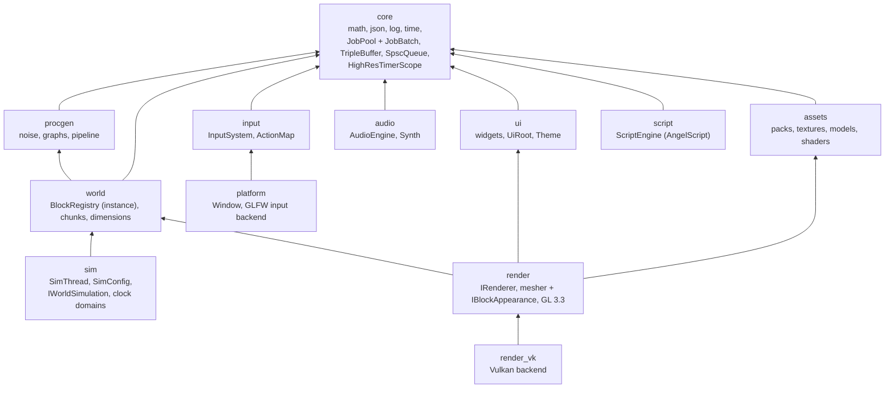

### 1b. Game layer and third-party libraries

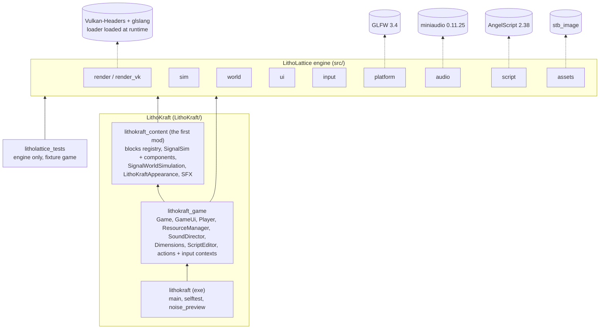

Every arrow points from the game toward the engine; no engine code includes anything from LithoKraft, and `litholattice_tests` proves the engine builds and runs with no game linked. The former weak spots (H1, H2: game content inside `world`, `sim`, `audio` and `input`) are fixed by the SDK split, see 2m.

---

## 2. Class diagrams per system

### 2a. World and chunks (`world`)

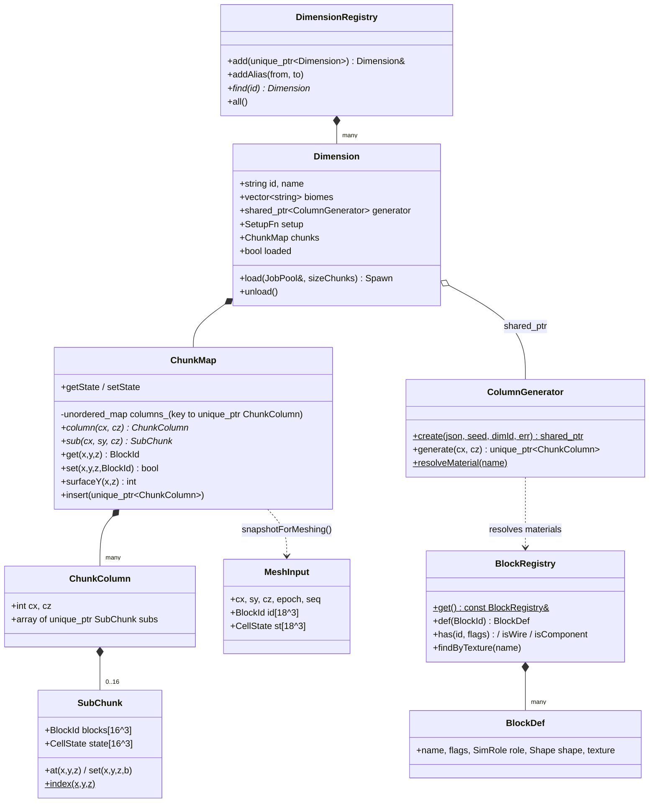

### 2b. Sim: engine scheduler and LithoKraft's simulation (`sim` + `lithokraft_content`)

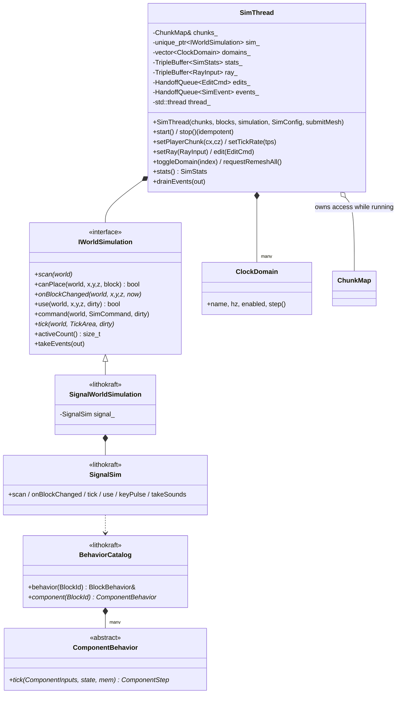

### 2c. Render backends (`render`, `render_vk`)

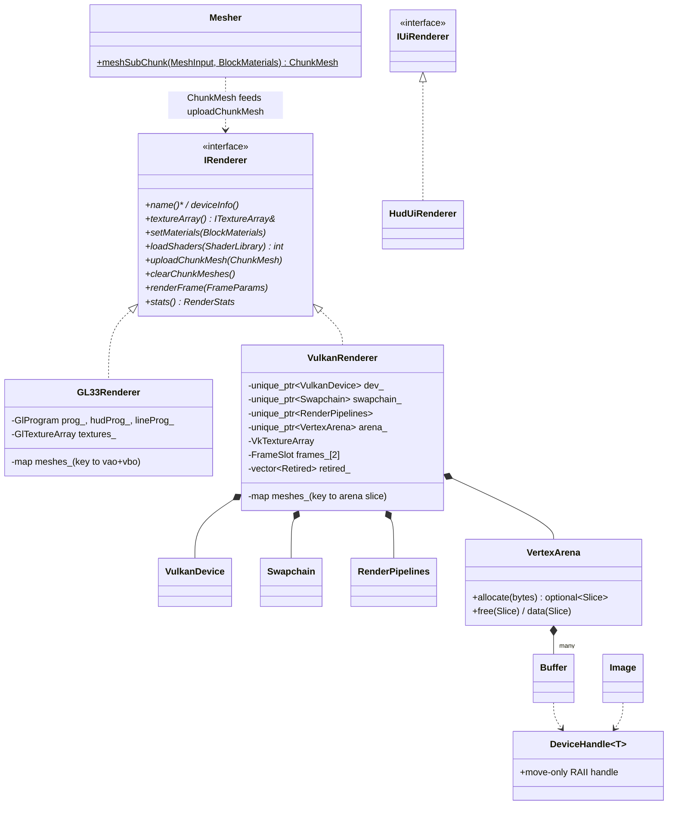

`createVulkanRenderer(desc, err)` returns `unique_ptr<IRenderer>` or nullptr, and the app falls back to GL 3.3. The concrete renderer classes live in .cpp files, so the rest of the code sees only `IRenderer`.

### 2d. Textures and assets (`assets` + render texture arrays)

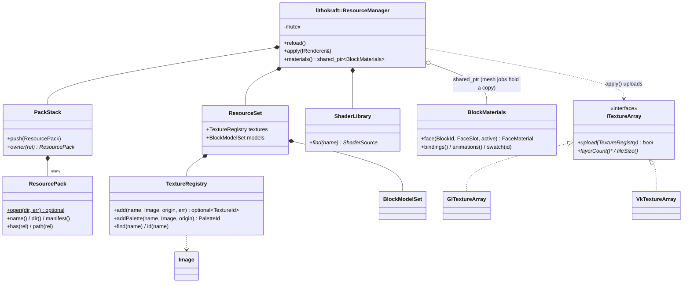

Pack order: engine base < game pack < art pack < mods.

### 2e. Input (`input` + `platform`)

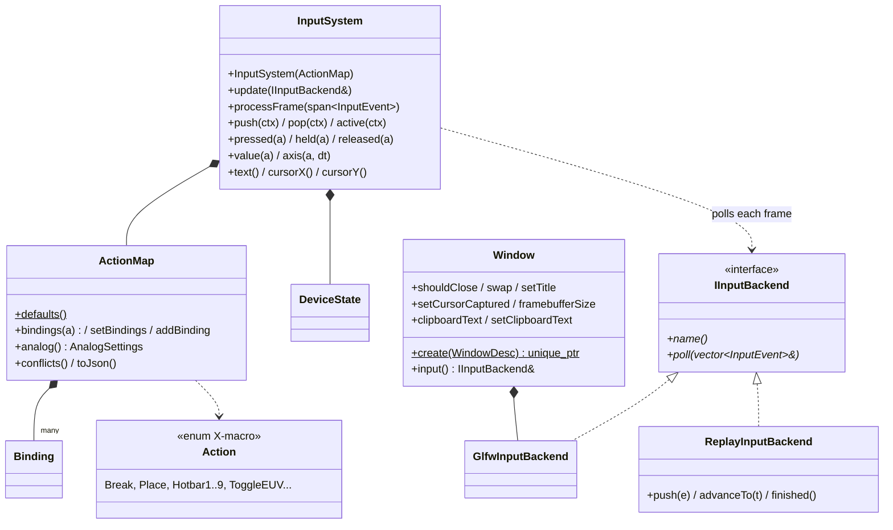

### 2f. Audio (`audio`)

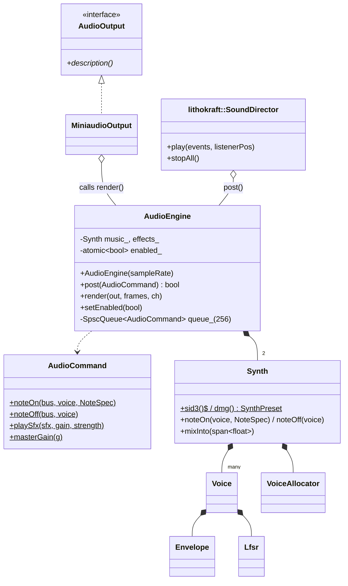

### 2g. UI, part 1: core (`ui`)

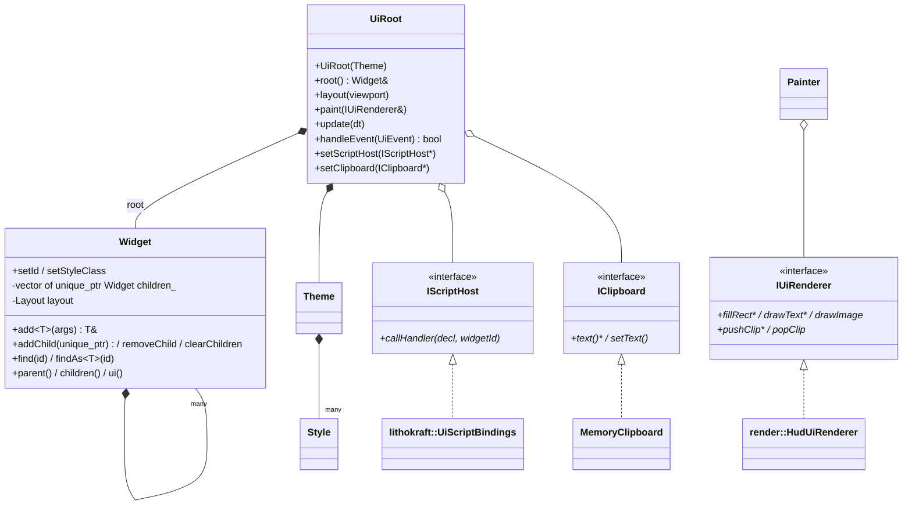

### 2h. UI, part 2: widget catalogue

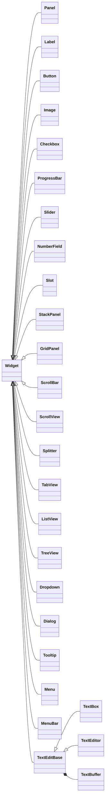

`widget_factory.cpp` builds these trees from the pack's UI JSON.

### 2i. Procgen, part 1: pipeline stages (`procgen`)

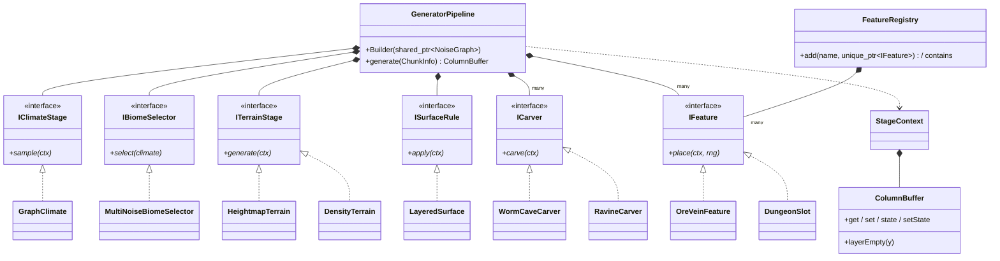

### 2j. Procgen, part 2: noise graphs

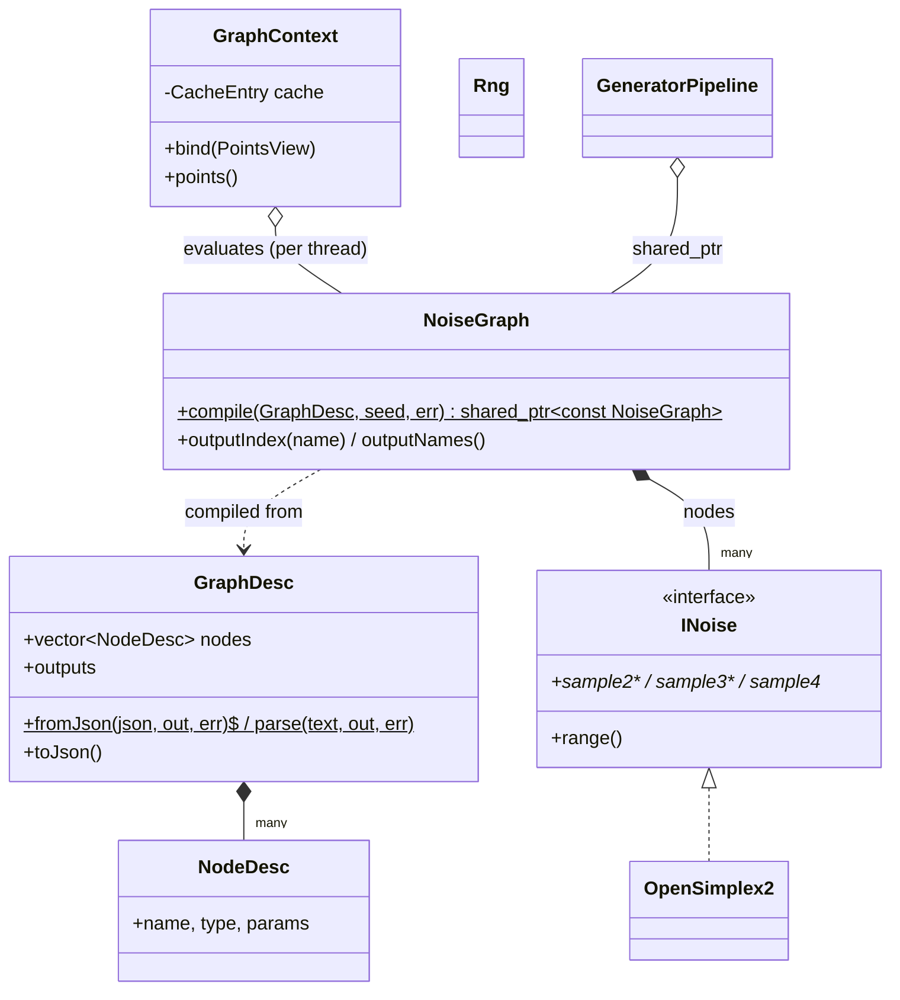

`loadGenerator(json, seed, resolveMaterial, err)` (generator_loader.cpp) builds a GeneratorPipeline from the worldgen JSON in the game pack.

### 2k. Script (`script`) and its game bindings

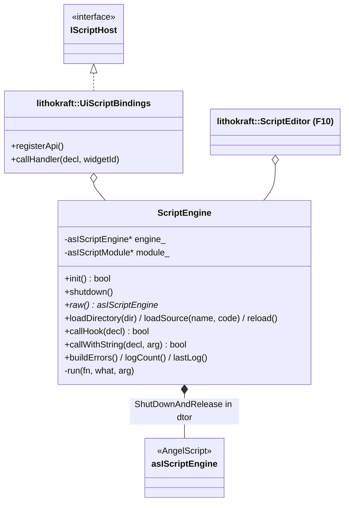

Modules are hot-swapped: the code builds `game.staging`, and only if that compiles does it discard `game` and rename staging to `game`, so a broken edit leaves the old scripts running.

### 2l. Game composition (`lithokraft::Game`)

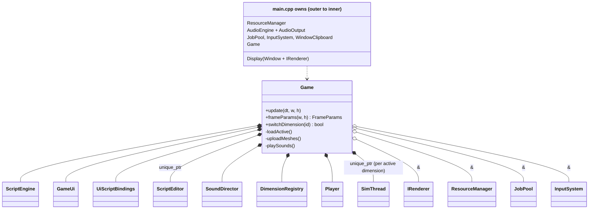

Objects are destroyed in reverse order of construction. `~Game` stops the sim thread and then calls `pool.waitIdle()`. After that the pool, the renderer and the window are destroyed.

---

### 2m. The SDK seams: engine interfaces and registries, LithoKraft implementations

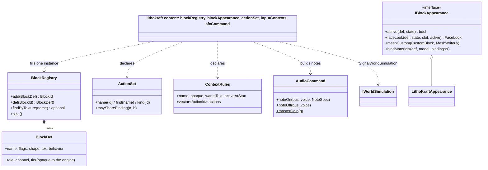

The engine knows only `kAir`, the generic block flags (`kFirstGameFlag` onward is the game's), the shapes and generic shader modes. A new game is a new set of these implementations; see `docs/ARCHITECTURE.md` in the repo.

---

## 3. Sequence: one frame and one tick, across threads

### 3a. Main (game/render) thread frame

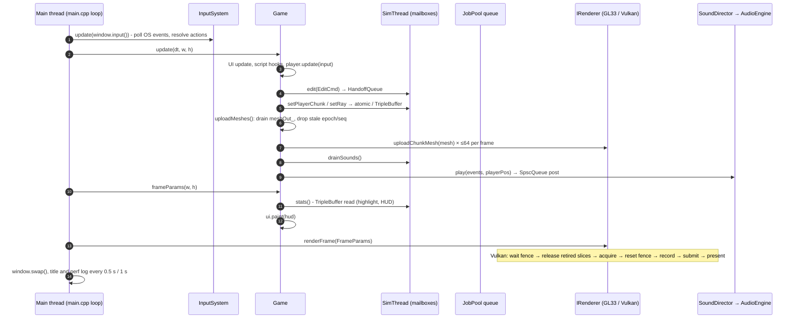

### 3b. Sim tick, mesh workers and audio callback (concurrent)

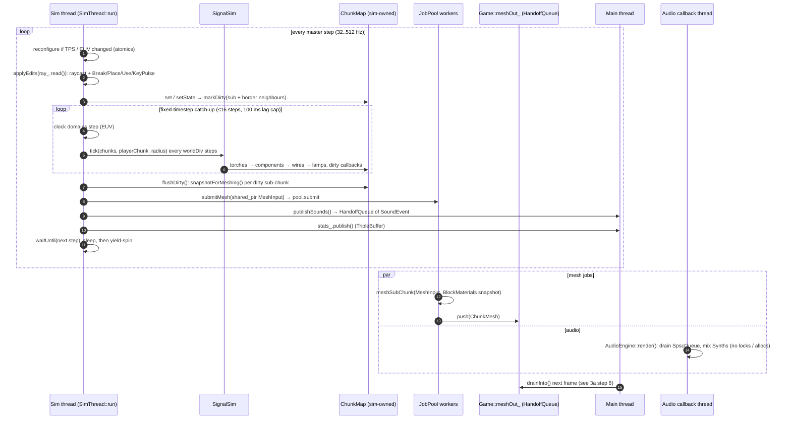

### 3c. Dimension load and switch (main thread, one time)

```mermaid
sequenceDiagram
  participant G as Game (main)
  participant Sim as SimThread
  participant R as IRenderer
  participant D as Dimension
  participant W as JobPool workers
  G->>Sim: sim_.reset() - stop and join; main owns the chunks again
  G->>R: clearChunkMeshes()
  G->>D: old.unload()
  G->>D: next.load(pool, size)
  D->>W: submit generate(cx, cz) per column
  W-->>D: HandoffQueue of unique_ptr ChunkColumn
  D->>D: busy-wait until all done, insert, setup() → Spawn
  G->>G: ++epoch, submit initial mesh snapshots
  G->>Sim: make_unique SimThread(chunks, ...) + start() - sim owns the chunks
```
